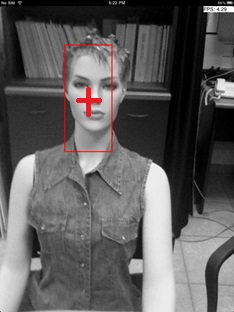

# Predator TLD on iOS

<p align="center">
  
</p>


This repository preserves a Technion iOS implementation derived from Zdeněk Kalal's Tracking-Learning-Detection (TLD) work. Starting from a selected bounding box, the code tracks image points, searches for matching object windows and can update its classifier during subsequent frames. The archive is a historical iPad application, not a tested current iOS release.

Students: Marian Mansour, Majd Srour. The [project report](docs/report.pdf) credits supervision by Aaron Wetzler and Yaron Honen. The pinned upstream README credits Aaron Wetzler and Prof. Ron Kimmel and also acknowledges Anton Anton's graphics/UI assistance.

*The unchanged historical screenshot includes a frame-rate readout. That value is original interface output, not a benchmark reproduced during maintenance.*

## Original code

The `source/` Git submodule pins [kenguish/Predator-iOS-Technion](https://github.com/kenguish/Predator-iOS-Technion) at `a63f005bf34b041ff0dd985a8e18083f2d3065eb`. Kenneth Anguish preserved the Technion implementation and added iOS 6/OpenCV compatibility fixes. This archive does not alter that revision or relabel it as new code. The [recovered report](docs/report.pdf) provides historical project context.

`Tracker.cpp` implements forward/backward Lucas–Kanade point tracking. `TldDetector.cpp` scans candidate windows, and `Tld.mm` combines tracker/detector decisions with patch-correlation and confidence checks. In this pinned revision, `tldProcessFrame` calls `classifier->train` for positive/negative patches when its `learning` flag permits; the application exposes learning controls.

An earlier handoff stated that online learning was omitted; the later pinned revision contains conditional `classifier->train` calls. This shows the learning path is implemented in source. It has not been compiled or exercised here, and equivalence to the complete reference TLD algorithm is unvalidated.

## Inspect the app

```sh
git clone --recurse-submodules https://github.com/twerdster/predator-tld-ios.git
cd predator-tld-ios
open source/Predator.xcodeproj
```

The historical `Predator` target uses Objective-C++, C++, bundled OpenCV 2 binaries and Apple camera/graphics frameworks. The pinned revision targets iOS 6.0. The bundled OpenCV files are prebuilt third-party binaries; they were not rebuilt or verified during recovery. Use your own signing setup; restoring it on modern Xcode may require replacement architectures, dependencies and removed APIs. This command opens the project for inspection and is not a verified installation procedure.

## Validation and limitations

Recovery checked the upstream revision, source entrypoints and project metadata. No compilation, physical-device run, tracking benchmark, learning evaluation or frame-rate test was recorded. No updated port or notebook is included. Source-level learning controls do not establish accuracy improvement or equivalence to every stage of Kalal's reference algorithm.

## Attribution and terms

Original notices remain in the pinned source. Several TLD files carry GPL redistribution notices; bundled libraries and other files have their own terms. This wrapper does not assign a new blanket license or supersede those notices. Authors can open an issue to contribute updates, correct attribution or request removal.

## Links

- [Project entry on Aaron Wetzler's website](https://twerdster.github.io/#predator-tld-on-ios)
- [Recovered original project report](docs/report.pdf)
- [Preserved original source and attribution](https://github.com/kenguish/Predator-iOS-Technion)
