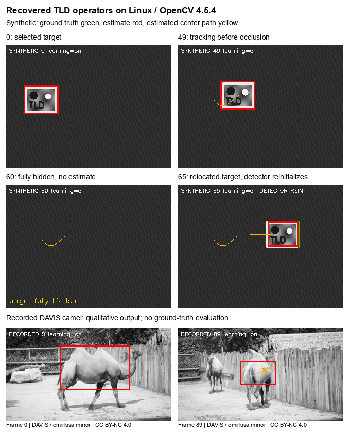

# Updated headless Predator pipeline

This C++17 target runs the recovered custom forward/backward Lucas–Kanade tracker, scanning detector, random-fern classifier, normalized-correlation validation and conditional learning. OpenCV 4 supplies core/image-processing primitives; the recovered tracking algorithm remains. The original project was developed for interactive object tracking on iPhone/iPad. This target accepts recorded or generated frames; the original iOS application stopped before compilation in Xcode 16.1.



Upper panels: **synthetic scene, online updates on**, green ground truth, red estimates, yellow estimated-center path. Lower panels: **recorded DAVIS camel**, without an accuracy evaluation. All panels show actual Linux output.

[Synthetic GIF](assets/synthetic-tracking.gif) · [MP4](assets/synthetic-tracking.mp4) · [Recorded GIF](assets/camel-tracking.gif) · [MP4](assets/camel-tracking.mp4)

## Build and run

Requirements: C++17, CMake 3.20+, OpenCV 4 **core/imgproc** development files. Python 3.10+ and FFmpeg support the video helper. C++ checks need neither a camera nor a GPU. From the repository root:

```sh
cmake -S updated -B build/predator -DCMAKE_BUILD_TYPE=RelWithDebInfo
cmake --build build/predator -j2
ctest --test-dir build/predator --output-on-failure
python3 updated/tools/run_demo.py --build-dir build/predator \
  --synthetic --learning 1 --output /path/to/new-demo-directory
```

The helper writes annotated frames, CSV/JSON and GIF/MP4 files. Use a new/empty output directory. `--learning 0` disables subsequent updates; initialization still trains. For recorded input, supply `--video input.mp4 --roi x,y,width,height`, selecting the first-frame box after resizing to 320 pixels wide. [BUILD.md](BUILD.md) covers commands, input formats and the private Linux dependency prefix, which requires its matching TBB 2 library.

## What was checked

Linux: Ubuntu 22.04, GCC 11.4, OpenCV 4.5.4. In the 120-frame generated scene, online updates gave mean visible-frame intersection-over-union (IoU) **0.946363**, with **105/105** visible frames at IoU ≥ 0.5. Updates off gave **0.874728**, **97/105**. Both settings rejected hidden frames 50–64 and first reached IoU ≥ 0.5 after relocation at frame 65; with updates on, detector reinitialization accepted that frame. Only the first-frame box was given to the tracker; later ground truth was used only for scoring/overlays.

On macOS/OpenCV 4.12, both update settings gave **0.934852**, **105/105**. These are environment-specific results from one regression scene, not a benchmark or general learning advantage.

One CTest program checks component behavior and invalid/border ROIs. The 120-frame Linux synthetic run with updates on passed ASan/UBSan with leak detection. Unchanged original-component controls reproduce ignored negative training, borrowed-buffer double-free and an out-of-bounds read; updated counterparts pass. Coverage is limited to exercised paths.

The 90-frame recorded camel run exercised the pipeline, with four detector reinitialization decisions and four lost-frame reports on Linux. DAVIS masks were not used for evaluation: boxes and trajectory are qualitative, without real-video accuracy or occlusion-recovery claims. See [VALIDATION.md](VALIDATION.md), [machine-readable results](VALIDATION.json) and [CSV traces](results/).

## Changes and limits

Adapters replace removed headers/APIs. Repairs address ownership, bounds, filtering, patch strides and candidate selection. Enabling existing negative fern counts deliberately changes classifier behavior, including initialization. [BUILD.md](BUILD.md#changes-from-the-recovered-code) distinguishes these adaptations; [source hashes](SOURCE_PROVENANCE.json) map them to unchanged originals in `../source/` at `a63f005bf34b041ff0dd985a8e18083f2d3065eb`.

Only the no-blur path is validated; the target holds one live TLD instance. Full reference-TLD equivalence, cross-platform bit parity, modern iOS/device operation and historical FPS are unverified. The main README remains the historical reference.

Original work: Marian Mansour and Majd Srour, based on Zdeněk Kalal’s TLD; original GPL notices remain. The historical README retains supervisor/UI credits. Codex prepared this adaptation for Aaron Wetzler.

Footage: [DAVIS](https://davischallenge.org/), Pont-Tuset, Perazzi, Caelles, Arbeláez, Sorkine-Hornung and Van Gool; MP4 from [emirkisa’s mirror](https://huggingface.co/datasets/emirkisa/DAVIS-2017-480p-mp4). DAVIS metadata and the mirror card specify **CC BY-NC 4.0**. Resizing, grayscale conversion, annotations and encoding are documented in [data provenance](DATA_PROVENANCE.json). Footage terms remain separate from source licensing.
